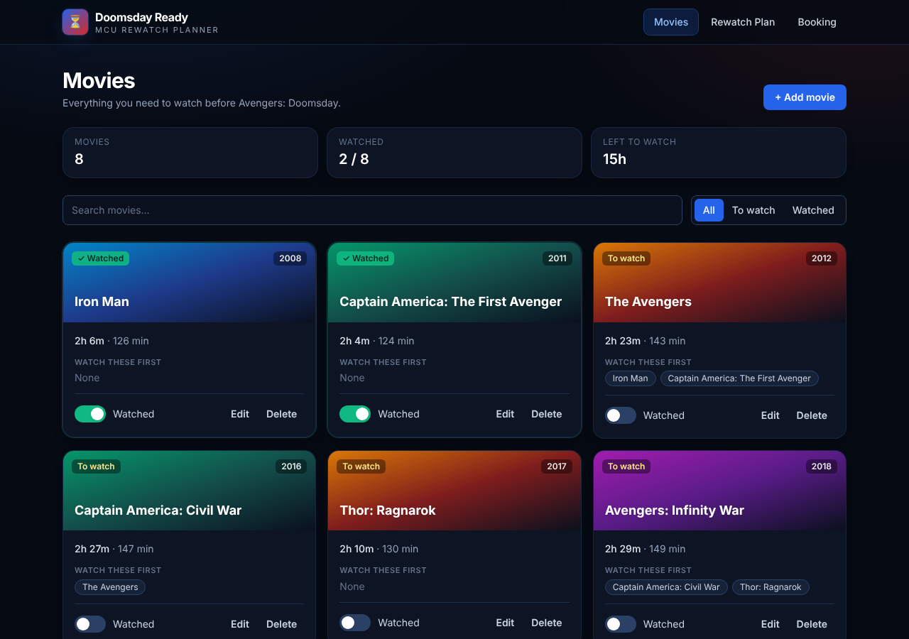
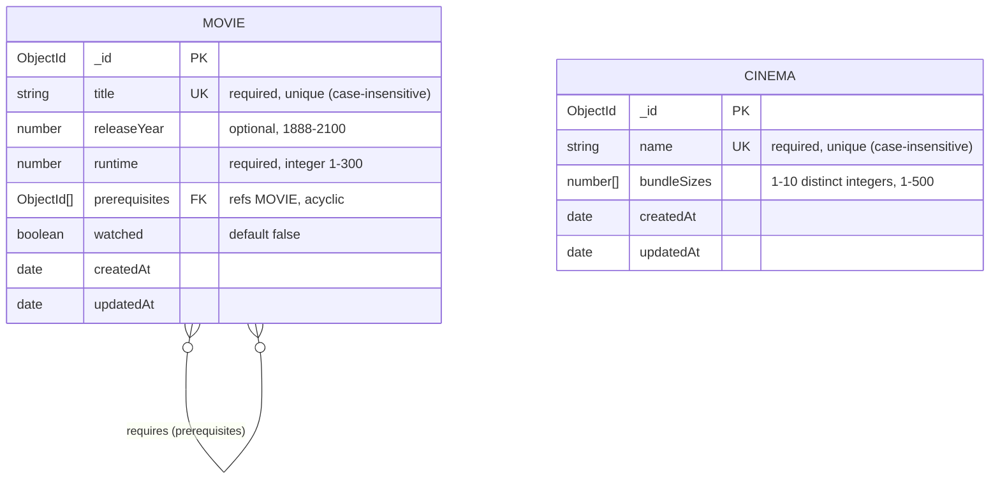
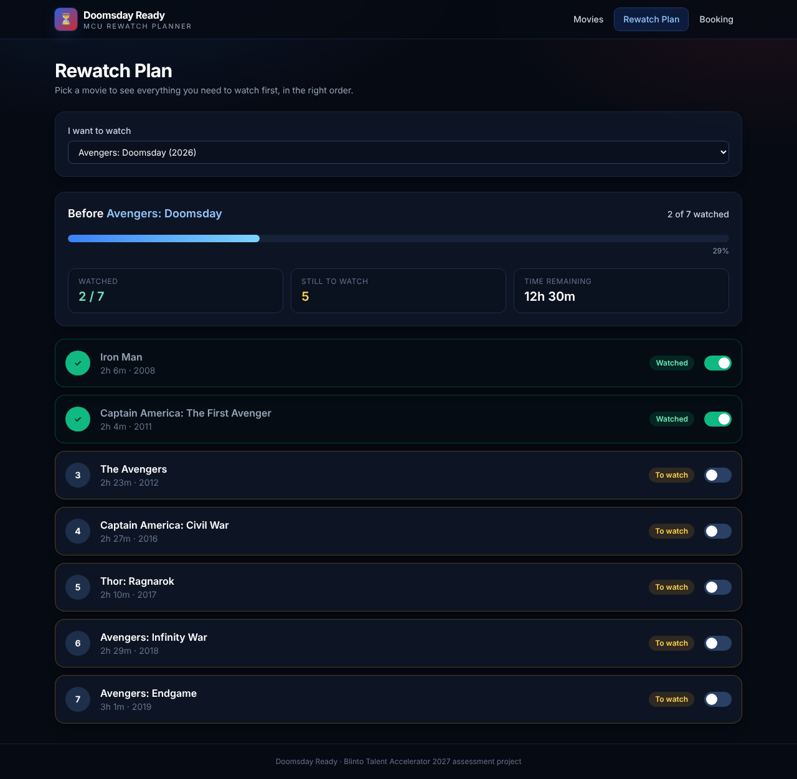
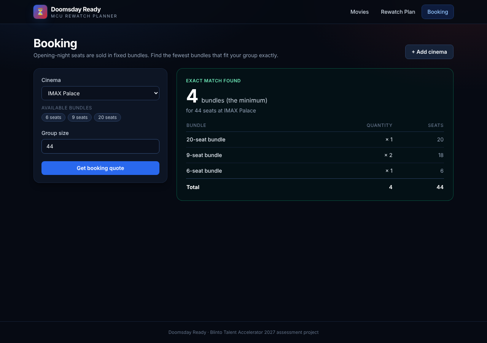
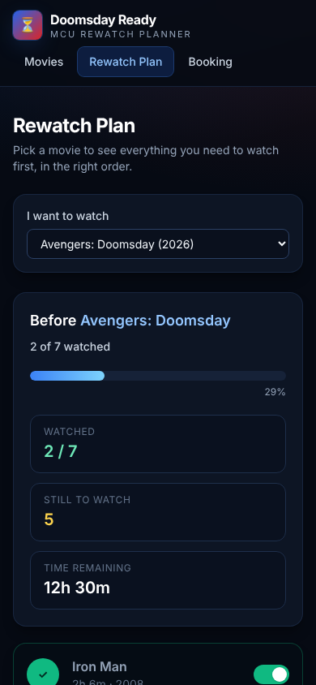

# Doomsday Ready

A full-stack MERN application that helps Marvel Cinematic Universe fans get ready for **Avengers: Doomsday**: plan the exact rewatch order from movie prerequisites, track progress, and work out the cheapest way to book opening-night seats that are only sold in fixed-size bundles.

Built for the Blinto Talent Accelerator 2027 Full Stack Developer Internship technical assessment.



---

## Table of contents

1. [Problem statement](#problem-statement)
2. [Features](#features)
3. [Technology stack](#technology-stack)
4. [Project structure](#project-structure)
5. [Getting started](#getting-started)
6. [API documentation](#api-documentation)
7. [Validation rules](#validation-rules)
8. [Data model](#data-model)
9. [Algorithms](#algorithms)
10. [Testing](#testing)
11. [Screenshots](#screenshots)
12. [Design decisions and assumptions](#design-decisions-and-assumptions)
13. [Known limitations](#known-limitations)
14. [AI usage disclosure](#ai-usage-disclosure)

---

## Problem statement

1. Each MCU movie can require other movies to be watched first (Avengers: Doomsday needs Endgame, which needs Infinity War, and so on). Fans need to know **everything** they must watch, **in what order**, how much they have **already watched**, and how much **viewing time is left**. The prerequisite relationships must never form a loop.
2. Cinemas sell opening-night seats only in **bundles** (for example 5 seats or 2 seats). For a group of a given size, buy the **fewest bundles** whose seats add up to **exactly** the group size, with no empty seats.

## Features

**Movies**
- Create, list, edit and delete movies (title, release year, runtime, prerequisites, watched flag).
- Mark movies watched or unwatched with a toggle.
- Prerequisites are validated: no unknown movies, no duplicates, no direct or indirect cycles (hand-written DFS).
- Deleting a movie that others depend on is blocked unless explicitly forced, so no dangling references remain.

**Rewatch plan**
- Pick any target movie and get every direct and indirect prerequisite exactly once, in a valid prerequisite-first order (hand-written DFS topological sort).
- Watched count, total count, and remaining runtime for unwatched prerequisites, all calculated by the backend.
- Progress bar, human-readable remaining time, and inline watched toggles.

**Booking**
- Create and list cinemas with their bundle sizes.
- Quote the minimum number of bundles for a group of 1 to 10,000 using hand-written bottom-up dynamic programming, with the exact bundle breakdown or a clear "Not possible" result.

**General**
- Dark cinematic, responsive UI (desktop, tablet, mobile) with loading, empty, success and error states.
- Centralised error handling, consistent JSON errors, automated tests, seed script, Docker Compose.

## Technology stack

| Layer | Tools |
|---|---|
| Frontend | React 19, Vite, Tailwind CSS 3, React Router 7, Fetch API |
| Backend | Node.js 22, Express 4, Mongoose 8 |
| Database | MongoDB |
| Testing | Jest, Supertest (against a real MongoDB) |
| Packaging | Docker, Docker Compose, nginx (serves the built frontend) |

No graph, topological-sort or coin-change libraries are used. The three algorithms are implemented from scratch.

## Project structure

```
doomsday-ready/
├── docker-compose.yml
├── README.md
├── docs/screenshots/
├── backend/
│   ├── Dockerfile
│   ├── .env.example
│   ├── package.json
│   ├── src/
│   │   ├── app.js                 Express app (middleware + routes), no listen()
│   │   ├── server.js              Connects to MongoDB and starts listening
│   │   ├── config/db.js           Mongoose connection
│   │   ├── models/                Movie.js, Cinema.js
│   │   ├── routes/                movieRoutes.js, cinemaRoutes.js
│   │   ├── controllers/           Thin HTTP handlers
│   │   ├── services/
│   │   │   ├── graphService.js    DFS cycle detection + DFS topological sort
│   │   │   ├── bookingService.js  Dynamic-programming minimum bundles
│   │   │   ├── movieService.js    Movie business rules, rewatch statistics
│   │   │   └── cinemaService.js   Cinema business rules, quote orchestration
│   │   ├── middleware/            errorHandler.js, validateObjectId.js
│   │   ├── utils/                 AppError, asyncHandler, validators
│   │   └── seed/                  seedData.js, seed.js
│   └── tests/
│       ├── unit/                  Pure algorithm + validator tests
│       └── integration/           HTTP + MongoDB tests
└── frontend/
    ├── Dockerfile, nginx.conf
    ├── vite.config.js, tailwind.config.js
    └── src/
        ├── main.jsx, App.jsx, index.css
        ├── pages/                 MoviesPage, RewatchPage, BookingPage
        ├── components/            Layout, MovieCard, MovieForm, CinemaForm, ui, ToastProvider
        ├── services/api.js        Fetch wrapper and endpoint functions
        ├── hooks/useApi.js        Loading / error / data hook
        └── utils/format.js        Duration formatting, helpers
```

Business logic lives in `services/`; controllers only translate HTTP to service calls.

## Getting started

### Prerequisites

- Node.js 18 or newer (developed on Node 22) and npm
- MongoDB 6 or newer running locally, **or** a MongoDB Atlas connection string, **or** Docker

### Option A: Docker Compose (one command)

```bash
docker compose up --build
```

- App: http://localhost:8080
- API: http://localhost:5000/api (exposed for Postman)

This starts MongoDB (with a persistent `mongo-data` volume), the backend, and the frontend served by nginx, which proxies `/api` to the backend. Demo data is seeded automatically on start (`SEED_ON_START=true`); seeding is idempotent. Stop with `Ctrl+C`; remove data with `docker compose down -v`.

### Option B: run locally

**1. MongoDB.** Start a local MongoDB on the default port, or use Atlas. A local instance needs no extra configuration. To use another server, set `MONGODB_URI` (next step).

**2. Backend**

```bash
cd backend
cp .env.example .env      # Windows: copy .env.example .env
npm install
npm run seed              # loads the example movies and demo cinemas
npm run dev               # or: npm start      (http://localhost:5000)
```

**3. Frontend** (in a second terminal)

```bash
cd frontend
npm install
npm run dev               # http://localhost:5173
```

In development Vite proxies `/api` to `http://localhost:5000`, so no CORS setup is needed. To point at a different backend, set `VITE_PROXY_TARGET` before `npm run dev`. For a production build run `npm run build` (output in `frontend/dist`).

### Environment variables

**Backend (`backend/.env`)**

| Variable | Default | Purpose |
|---|---|---|
| `PORT` | `5000` | API port |
| `MONGODB_URI` | `mongodb://127.0.0.1:27017/doomsday_ready` | MongoDB connection string |
| `CORS_ORIGIN` | `http://localhost:5173` | Comma-separated browser origins allowed to call the API |
| `SEED_ON_START` | `false` | `true` inserts example data on server start |
| `MONGODB_URI_TEST` | `mongodb://127.0.0.1:27017/doomsday_ready_test` | Database for integration tests (name must contain `test`) |

**Frontend**: `VITE_API_URL` (default `/api`) is the API base URL used by the browser; `VITE_PROXY_TARGET` (dev only) is where Vite proxies `/api`.

Never commit `.env`; it is git-ignored. Only `.env.example` is tracked.

### Seed data

`npm run seed` (in `backend/`) inserts the assessment's movies and four demo cinemas through the same validated service layer the API uses.

| Movie | Year | Runtime | Watch these first |
|---|---:|---:|---|
| Iron Man | 2008 | 126 | none |
| Captain America: The First Avenger | 2011 | 124 | none |
| The Avengers | 2012 | 143 | Iron Man, The First Avenger |
| Captain America: Civil War | 2016 | 147 | The Avengers |
| Thor: Ragnarok | 2017 | 130 | none |
| Avengers: Infinity War | 2018 | 149 | Civil War, Ragnarok |
| Avengers: Endgame | 2019 | 181 | Infinity War |
| Avengers: Doomsday | 2026 | 150 (estimate) | Endgame |

Demo cinemas use the assessment's booking examples: Grand Screen Cineplex `[1,3,4]`, Metro Cinema Hall `[2,5]`, IMAX Palace `[6,9,20]`, Boutique Cinema `[4,6]`.

The seed is **idempotent**: records are matched by title or name, existing seed movies are brought back in line with the table above, and records you added yourself are left untouched.

## API documentation

Base URL: `http://localhost:5000/api`. All bodies are JSON. Resource IDs are MongoDB ObjectIds exposed as `id`.

### Error format

Every error has the same shape:

```json
{ "error": "VALIDATION_ERROR", "message": "Runtime must be an integer between 1 and 300 minutes.",
  "details": [{ "field": "runtime", "message": "Runtime must be an integer between 1 and 300 minutes." }] }
```

`details` is present for validation errors only.

| Status | `error` code | When |
|---|---|---|
| 400 | `VALIDATION_ERROR` | Invalid or unknown body fields, invalid `groupSize` |
| 400 | `INVALID_ID` | `:id` is not a valid ObjectId |
| 400 | `INVALID_PREREQUISITE` | A prerequisite movie does not exist |
| 400 | `INVALID_JSON` | Malformed JSON body |
| 404 | `NOT_FOUND` / `ROUTE_NOT_FOUND` | Movie, cinema or route does not exist |
| 409 | `CIRCULAR_DEPENDENCY` | Prerequisites would create a loop (including a movie depending on itself) |
| 409 | `DUPLICATE_TITLE` / `DUPLICATE_NAME` | Movie title or cinema name already exists (case-insensitive) |
| 409 | `HAS_DEPENDENTS` | Deleting a movie that other movies require |
| 500 | `INTERNAL_ERROR` | Unexpected failure; details are logged server-side only |

### Movies

#### `POST /api/movies`: create a movie, `201`

```json
{ "title": "Iron Man", "releaseYear": 2008, "runtime": 126, "prerequisites": [], "watched": false }
```

`releaseYear`, `prerequisites` and `watched` are optional. Response:

```json
{ "id": "6b0001d145603c3aa45626bd", "title": "Iron Man", "releaseYear": 2008, "runtime": 126,
  "prerequisites": [], "watched": false,
  "createdAt": "2026-11-20T08:16:17.222Z", "updatedAt": "2026-11-20T08:16:17.222Z" }
```

#### `GET /api/movies`: list movies, `200`

Returns an array of movies sorted by release year then title. `prerequisites` holds movie IDs.

#### `GET /api/movies/:id`: one movie, `200`

#### `PATCH /api/movies/:id`: partial update, `200`

Send any subset of `title`, `releaseYear`, `runtime`, `prerequisites`, `watched`. Supplying `prerequisites` replaces the whole list.

```json
{ "watched": true }
```

```json
{ "prerequisites": ["6b0001d145603c3aa45626bd", "6b0001d145603c3aa45626be"] }
```

Creating a loop is rejected and nothing is saved. For example, making Avengers: Endgame a prerequisite of Iron Man:

```
HTTP/1.1 409 Conflict
{ "error": "CIRCULAR_DEPENDENCY", "message": "This prerequisite selection creates a circular dependency." }
```

#### `DELETE /api/movies/:id`: delete, `200`

If other movies require it the request fails with `409 HAS_DEPENDENTS` (the message lists them). `DELETE /api/movies/:id?force=true` removes the movie **and** pulls it out of every dependent's prerequisites, so no invalid references remain.

```json
{ "id": "6b0001d145603c3aa45626bd", "title": "Iron Man", "removedFromDependents": 1 }
```

#### `GET /api/movies/:id/rewatch-order`: prerequisite-first order, `200`

```json
{
  "targetMovie": { "id": "6b0001d145603c3aa45626c3", "title": "Avengers: Doomsday" },
  "movies": [
    { "id": "6b0001d145603c3aa45626bd", "title": "Iron Man", "releaseYear": 2008, "runtime": 126, "watched": true },
    { "id": "6b0001d145603c3aa45626be", "title": "Captain America: The First Avenger", "releaseYear": 2011, "runtime": 124, "watched": false }
  ],
  "watchedCount": 1,
  "totalMovies": 7,
  "remainingRuntime": 874
}
```

(`movies` is shortened here; the real response lists all 7.) The target movie is excluded from the list and from every statistic. A movie with no prerequisites returns `"movies": []` with zeros.

### Cinemas

#### `POST /api/cinemas`: create a cinema, `201`

```json
{ "name": "IMAX Palace", "bundleSizes": [20, 6, 9] }
```

Bundle sizes are stored in ascending order: `"bundleSizes": [6, 9, 20]`.

#### `GET /api/cinemas`: list cinemas, `200` (sorted by name)

#### `GET /api/cinemas/:id`: cinema details, `200`

#### `GET /api/cinemas/:id/booking?groupSize=44`: booking quote, `200`

```json
{
  "cinema": { "id": "6b0001d145603c3aa45626c8", "name": "IMAX Palace", "bundleSizes": [6, 9, 20] },
  "possible": true,
  "groupSize": 44,
  "totalBundles": 4,
  "bundles": { "6": 1, "9": 2, "20": 1 }
}
```

`bundles` maps bundle size to quantity. When no exact combination exists (still `200`, because the request was valid):

```json
{
  "cinema": { "id": "…", "name": "Boutique Cinema", "bundleSizes": [4, 6] },
  "possible": false,
  "groupSize": 7,
  "message": "No exact bundle combination is possible for this group size."
}
```

### Health

`GET /api/health` returns `{ "status": "ok" }`.

### Quick curl tour

```bash
curl localhost:5000/api/movies
curl localhost:5000/api/movies/<doomsdayId>/rewatch-order
curl -X PATCH localhost:5000/api/movies/<ironManId> -H 'Content-Type: application/json' \
     -d '{"prerequisites":["<endgameId>"]}'                       # 409 CIRCULAR_DEPENDENCY
curl "localhost:5000/api/cinemas/<cinemaId>/booking?groupSize=11"
```

## Validation rules

**Movie**

| Field | Rule |
|---|---|
| `title` | Required, trimmed, 1 to 200 characters, unique ignoring letter case |
| `releaseYear` | Optional integer from 1888 to 2100 (`null` allowed) |
| `runtime` | Required integer from 1 to 300 |
| `prerequisites` | Array of valid ObjectIds, no duplicates, every movie must exist, must not create a cycle |
| `watched` | Boolean, default `false` |
| other fields | Rejected, so typos are never silently ignored |

**Cinema**

| Field | Rule |
|---|---|
| `name` | Required, trimmed, up to 120 characters, unique ignoring letter case |
| `bundleSizes` | Array of 1 to 10 **distinct** integers, each from 1 to 500 |

**Booking**: `groupSize` must be a plain whole number from 1 to 10,000 (so `6.5`, `abc`, `1e3` and empty values are rejected).

The same rules are enforced twice: in the request validators and again by the Mongoose schemas. The frontend repeats the cheap checks for instant feedback, but the backend is always the authority.

## Data model



`Movie.prerequisites` is a self-referencing many-to-many relationship stored as an array of ObjectIds, so each edge is stored once and never duplicated. Cinema is independent of Movie.

Indexes: unique case-insensitive index on `Movie.title` and `Cinema.name` (collation, strength 2), and a multikey index on `Movie.prerequisites` so "who depends on this movie?" (used when deleting) does not scan the collection.

## Algorithms

All three algorithms live in `backend/src/services/` and are written from scratch.

### Circular dependency detection (DFS)

*File: `graphService.js` → `findCycleFrom`, `wouldCreateCycle`*

The movies form a directed graph where an edge `A → B` means "A requires B first". A cycle means a movie transitively requires itself.

1. Load every movie's prerequisites into an adjacency map.
2. Replace the edited movie's entry with the **proposed** prerequisites (for a new movie, the entry is added). The stored data is not touched yet.
3. Run a depth-first search from that movie using three-colour marking: unvisited, **on the current path** (gray), finished (black).
4. If the search reaches a node that is already on the current path, there is a cycle, so the request fails with `409 CIRCULAR_DEPENDENCY` and nothing is saved.

Only a path through the edited movie can be a new cycle, so searching from that movie is enough. A movie listing itself is the shortest cycle and is caught the same way. A shared prerequisite reached by two routes (a "diamond") is finished, not on the path, so it is correctly **not** treated as a cycle. The check runs on both create and update.

*Complexity:* O(V + E) time and O(V) space per validation, where V is the number of movies and E the number of prerequisite links.

### Rewatch order (DFS topological sort)

*File: `graphService.js` → `topologicalPrerequisites`*

1. Start a DFS at the target movie.
2. Visit each prerequisite (in the order stored) before doing anything with the movie itself.
3. After all of a movie's prerequisites are done, append it to the result (**post-order**).
4. A visited set ensures each movie is added once, even if several movies require it.
5. Drop the target from the result.

Because a movie is appended only after everything it needs, every prerequisite is guaranteed to appear before the movie that depends on it. Visiting prerequisites in stored order makes the output deterministic. For the seed data, Doomsday gives: Iron Man, Captain America: The First Avenger, The Avengers, Civil War, Thor: Ragnarok, Infinity War, Endgame. The function also runs the cycle check first, so bad data in the database returns a `409` instead of recursing forever.

Watched count, total, and remaining runtime are then computed by the service over that list (unwatched runtimes only), and exclude the target.

*Complexity:* O(V + E) time, O(V) space.

### Minimum bundles (dynamic programming)

*File: `bookingService.js` → `calculateMinimumBundles`*

This is the minimum-coin-change problem with bundle sizes as coins.

- `dp[a]` = fewest bundles that add up to exactly `a` seats (`dp[0] = 0`, unreachable = ∞).
- `last[a]` = the bundle size used as the final bundle in that best solution.
- For each amount `a` from 1 to `groupSize`, for each bundle size `s ≤ a` with `dp[a − s]` reachable: `dp[a] = min(dp[a], dp[a − s] + 1)`, recording `last[a]` when it improves.
- If `dp[groupSize]` is ∞, the answer is "not possible". Otherwise rebuild the combination by following `last` from `groupSize` down to 0 and counting each size.

A greedy "largest bundle first" approach is wrong here (for sizes 1, 3, 4 and a group of 6 greedy gives 4+1+1 = 3 bundles, but 3+3 = 2 is optimal), which is why DP is used.

**Tie-breaking rule (deterministic):** bundle sizes are tried from largest to smallest and a candidate replaces the current best only if it is *strictly* better. So when several bundle sizes give the same minimum for an amount, the **largest** size is chosen as that amount's final bundle. The result therefore does not depend on the order in which sizes were supplied (cinemas also store sizes sorted).

*Complexity:* O(groupSize × bundleCount) time and O(groupSize) space. At the limits (10,000 seats × 10 sizes) that is about 100,000 steps.

## Testing

Tests need a running MongoDB for the integration suite. By default they use `mongodb://127.0.0.1:27017/doomsday_ready_test` (override with `MONGODB_URI_TEST`; the name must contain `test`, and the database is dropped when the run finishes, so your real data is never touched).

```bash
cd backend
npm test                  # everything (unit + integration)
npm run test:unit         # algorithms and validators only, no database needed
npm run test:integration  # HTTP + MongoDB tests
```

**Unit tests** (`tests/unit`): graph and booking logic
- DFS cycle detection: valid graph, direct self-dependency, indirect cycles (including Iron Man → … → Endgame → … → Iron Man), valid prerequisite updates, new movie, diamond graphs, cycle path reporting, no mutation of input.
- Topological order: Doomsday (7 movies, each once, prerequisites first, exact sample order), Civil War, Thor: Ragnarok (empty), shared prerequisites appear once, stored cycles throw.
- Booking DP: all four assessment examples, group size 1, single bundle size (divisible and not), exact-fit, group size 10,000, impossible cases, exact seat matching and count consistency over many inputs, **brute-force cross-check of minimality**, deterministic tie-breaking independent of input order, group-size and cinema validators including boundaries.

**Integration tests** (`tests/integration`): REST API against MongoDB
- Movies: valid create, duplicate title (case-insensitive), invalid runtimes, missing title, bad/nonexistent/duplicate prerequisites, unknown fields, invalid JSON, watched toggle, edit, rename conflict, prerequisite updates, `CIRCULAR_DEPENDENCY` 409 for assessment case 4 / self / indirect, rejected update leaves data unchanged, 404 and invalid-ID handling.
- Rewatch: assessment cases 1 to 3, watched count, remaining runtime, target excluded from statistics, all-watched, dynamic recalculation after prerequisite changes.
- Delete: free delete, `HAS_DEPENDENTS` block, force-delete removes dangling references.
- Cinemas and booking: create/list/details, duplicate names, every bundle-size validation rule, all four booking examples, limits 1 and 10,000, invalid group sizes, missing/invalid IDs.

**Latest run (Node 22, MongoDB 8.3.7 on Linux):** 4 suites, **132 tests, all passing** (63 unit + 69 integration).

The UI was also exercised end to end in headless Chrome against the running stack (movie create/edit/delete, cycle and duplicate errors, watched toggles, rewatch plan, bookings including "not possible", adding a cinema, mobile overflow). That was a one-off manual-style script and is not part of the repository's automated tests.

## Screenshots

| Movies | Rewatch Plan |
|---|---|
|  |  |

| Booking | Rewatch Plan (mobile) |
|---|---|
|  |  |

## Design decisions and assumptions

The brief left some points open. These are the choices made:

- **Release year is optional**; runtime is required. The brief only marked the title as required.
- **A movie depending on itself returns `409 CIRCULAR_DEPENDENCY`** (a direct self-dependency is the smallest cycle), not a generic validation error.
- **A prerequisite ID that does not exist returns `400 INVALID_PREREQUISITE`**, because the request is malformed rather than the target resource missing.
- **Delete is blocked by default when dependents exist**, with an explicit `?force=true` that removes the references. This avoids silently changing other movies.
- **Titles and cinema names are unique ignoring case** (`iron man` clashes with `Iron Man`).
- **An impossible booking is `200` with `possible: false`**, since the request was valid and the answer is "no".
- **Bundle sizes are stored ascending** and the tie-break prefers the larger bundle (documented above).
- **Avengers: Doomsday's runtime is an estimate** (150 minutes) because no official runtime exists. Edit it in the UI if you prefer.
- **Placeholder posters** are generated gradients rather than copyrighted artwork or hot-linked images.
- Additional endpoints beyond the required list: `GET /api/movies/:id`, `DELETE /api/movies/:id`, `GET /api/cinemas/:id`, `GET /api/health`.

## Known limitations

- **No authentication or per-user data.** Everyone using the database shares one movie list and one watched state.
- **No transactions.** Cycle validation reads the graph and then saves. Two simultaneous requests that each look safe on their own could, in principle, together create a cycle. Rewatch ordering still detects any stored cycle and returns a `409` rather than failing.
- **No automated frontend tests.** The frontend has been checked with a one-off browser run, not a committed test suite.
- **Docker Compose configuration was validated (`docker compose config`) but could not be built or run in the environment where this project was developed**, because no Docker daemon was available there. Please run `docker compose up --build` once and report any issue.
- Quotes are calculated on request and are not stored; there is no actual seat reservation or payment.

## AI usage disclosure

AI assistance was used heavily on this project, and it should be read in that light.

- **Tool:** Anthropic's Claude (Claude Sonnet 5.5), used through an agentic coding workflow with file-system and terminal access.
- **What the AI did:** from the assessment brief, it designed the architecture and folder structure and wrote the application code: the Express/Mongoose backend, the **three required algorithms** (DFS cycle detection, DFS topological sort, dynamic-programming bundle calculation), the validators, the React frontend and its styling, the Jest/Supertest tests, the seed script, the Docker files, and this README. It also ran the tests and a headless-browser check, and fixed the issues they exposed (for example, a model validator that rejected a missing release year).
- **What the person submitting provided:** the assessment requirements and a set of reference screenshots of movie-tracker and cinema-booking interfaces that guided the visual direction.
- **Therefore:** the code and algorithms in this repository were **AI-generated**, not independently written by the submitting developer. The algorithm explanations above are provided so they can be understood and defended, not to imply they were hand-authored without assistance.
- **Verification:** test results quoted in this README come from tests actually executed. Anything that was not executed (Docker) is stated in [Known limitations](#known-limitations).
